# Structure de la base de données — OChantier Admin

> Généré automatiquement depuis les migrations Laravel (`database/migrations`).
> 77 tables. Types tels que produits par le schéma (SQLite en dev).

## Sommaire

- **Socle Laravel (auth, cache, files d'attente)** : [`users`](#users), [`password_reset_tokens`](#password_reset_tokens), [`sessions`](#sessions), [`cache`](#cache), [`cache_locks`](#cache_locks), [`jobs`](#jobs), [`job_batches`](#job_batches), [`failed_jobs`](#failed_jobs)
- **Promoteurs** : [`promoters`](#promoters), [`promoter_documents`](#promoter_documents), [`promoter_activities`](#promoter_activities)
- **Ouvriers** : [`workers`](#workers), [`worker_documents`](#worker_documents), [`worker_experiences`](#worker_experiences), [`worker_periods`](#worker_periods), [`worker_activities`](#worker_activities)
- **Commerciaux** : [`sales_agents`](#sales_agents), [`sales_agent_documents`](#sales_agent_documents), [`sales_agent_periods`](#sales_agent_periods), [`sales_agent_objectives`](#sales_agent_objectives), [`sales_agent_adjustments`](#sales_agent_adjustments), [`sales_agent_rewards`](#sales_agent_rewards), [`sales_agent_appreciations`](#sales_agent_appreciations), [`sales_agent_field_activities`](#sales_agent_field_activities), [`sales_agent_activities`](#sales_agent_activities), [`sales_rankings`](#sales_rankings)
- **Chantiers** : [`sites`](#sites), [`site_documents`](#site_documents), [`site_incidents`](#site_incidents), [`site_activities`](#site_activities)
- **Besoins & Offres** : [`needs`](#needs), [`need_lines`](#need_lines), [`need_offers`](#need_offers), [`need_assignments`](#need_assignments), [`need_documents`](#need_documents), [`need_activities`](#need_activities), [`promoter_offers`](#promoter_offers), [`promoter_offer_profiles`](#promoter_offer_profiles), [`promoter_offer_activities`](#promoter_offer_activities)
- **Matching** : [`matching_cycles`](#matching_cycles), [`matching_selections`](#matching_selections), [`matching_rejections`](#matching_rejections), [`matching_derogations`](#matching_derogations), [`matching_recalculations`](#matching_recalculations), [`matching_notifications`](#matching_notifications), [`matching_audits`](#matching_audits)
- **Pointages** : [`attendances`](#attendances), [`attendance_anomalies`](#attendance_anomalies), [`attendance_corrections`](#attendance_corrections), [`attendance_activities`](#attendance_activities)
- **Paiements** : [`payments`](#payments), [`payment_items`](#payment_items), [`payment_refunds`](#payment_refunds), [`payment_activities`](#payment_activities), [`payout_batches`](#payout_batches), [`payment_notifications`](#payment_notifications)
- **Abonnements** : [`subscription_plans`](#subscription_plans), [`subscriptions`](#subscriptions), [`subscription_users`](#subscription_users), [`subscription_invoices`](#subscription_invoices), [`subscription_activities`](#subscription_activities)
- **Finance & Reporting** : [`finance_archives`](#finance_archives), [`finance_closings`](#finance_closings), [`finance_views`](#finance_views), [`finance_reports`](#finance_reports), [`finance_audits`](#finance_audits), [`finance_resolutions`](#finance_resolutions)
- **Avis & litiges** : [`reviews`](#reviews), [`disputes`](#disputes), [`claims`](#claims), [`quality_activities`](#quality_activities), [`quality_notifications`](#quality_notifications)
- **Rapports & analyses** : [`analytics_reports`](#analytics_reports), [`analytics_schedules`](#analytics_schedules)
- **Paramètres** : [`settings`](#settings), [`setting_changes`](#setting_changes), [`integrations`](#integrations)

## Socle Laravel (auth, cache, files d'attente)

### `users`

| Colonne | Type | Null | Défaut | Clés |
|---|---|---|---|---|
| `id` | integer | non |  | PK |
| `name` | varchar | non |  |  |
| `email` | varchar | non |  | UNIQUE |
| `email_verified_at` | datetime | oui |  |  |
| `password` | varchar | non |  |  |
| `remember_token` | varchar | oui |  |  |
| `created_at` | datetime | oui |  |  |
| `updated_at` | datetime | oui |  |  |
| `phone` | varchar | oui |  |  |
| `role` | varchar | non | 'Super administrateur' |  |
| `status` | varchar | non | 'Actif' |  |
| `modules` | varchar | oui |  |  |
| `two_factor` | tinyint(1) | non | '1' |  |
| `last_login_at` | datetime | oui |  |  |
| `invitation_expires_on` | date | oui |  |  |

Index : `UNIQUE (email)`

### `password_reset_tokens`

| Colonne | Type | Null | Défaut | Clés |
|---|---|---|---|---|
| `email` | varchar | non |  | PK |
| `token` | varchar | non |  |  |
| `created_at` | datetime | oui |  |  |

### `sessions`

| Colonne | Type | Null | Défaut | Clés |
|---|---|---|---|---|
| `id` | varchar | non |  | PK |
| `user_id` | integer | oui |  |  |
| `ip_address` | varchar | oui |  |  |
| `user_agent` | text | oui |  |  |
| `payload` | text | non |  |  |
| `last_activity` | integer | non |  |  |

Index : `(last_activity)` ; `(user_id)`

### `cache`

| Colonne | Type | Null | Défaut | Clés |
|---|---|---|---|---|
| `key` | varchar | non |  | PK |
| `value` | text | non |  |  |
| `expiration` | integer | non |  |  |

Index : `(expiration)`

### `cache_locks`

| Colonne | Type | Null | Défaut | Clés |
|---|---|---|---|---|
| `key` | varchar | non |  | PK |
| `owner` | varchar | non |  |  |
| `expiration` | integer | non |  |  |

Index : `(expiration)`

### `jobs`

| Colonne | Type | Null | Défaut | Clés |
|---|---|---|---|---|
| `id` | integer | non |  | PK |
| `queue` | varchar | non |  |  |
| `payload` | text | non |  |  |
| `attempts` | integer | non |  |  |
| `reserved_at` | integer | oui |  |  |
| `available_at` | integer | non |  |  |
| `created_at` | integer | non |  |  |

Index : `(queue)`

### `job_batches`

| Colonne | Type | Null | Défaut | Clés |
|---|---|---|---|---|
| `id` | varchar | non |  | PK |
| `name` | varchar | non |  |  |
| `total_jobs` | integer | non |  |  |
| `pending_jobs` | integer | non |  |  |
| `failed_jobs` | integer | non |  |  |
| `failed_job_ids` | text | non |  |  |
| `options` | text | oui |  |  |
| `cancelled_at` | integer | oui |  |  |
| `created_at` | integer | non |  |  |
| `finished_at` | integer | oui |  |  |

### `failed_jobs`

| Colonne | Type | Null | Défaut | Clés |
|---|---|---|---|---|
| `id` | integer | non |  | PK |
| `uuid` | varchar | non |  | UNIQUE |
| `connection` | varchar | non |  |  |
| `queue` | varchar | non |  |  |
| `payload` | text | non |  |  |
| `exception` | text | non |  |  |
| `failed_at` | datetime | non | CURRENT_TIMESTAMP |  |

Index : `UNIQUE (uuid)` ; `(connection, queue, failed_at)`

## Promoteurs

### `promoters`

| Colonne | Type | Null | Défaut | Clés |
|---|---|---|---|---|
| `id` | integer | non |  | PK |
| `slug` | varchar | non |  | UNIQUE |
| `name` | varchar | non |  |  |
| `legal_form` | varchar | non |  |  |
| `rccm` | varchar | non |  |  |
| `ncc` | varchar | oui |  |  |
| `sector` | varchar | oui |  |  |
| `head_office` | varchar | non |  |  |
| `representative` | varchar | non |  |  |
| `representative_role` | varchar | oui |  |  |
| `phone` | varchar | non |  |  |
| `email` | varchar | non |  |  |
| `account_type` | varchar | non |  |  |
| `location` | varchar | non |  |  |
| `status` | varchar | non |  |  |
| `payment_status` | varchar | non |  |  |
| `note` | text | oui |  |  |
| `suspension_reason` | text | oui |  |  |
| `suspended_at` | date | oui |  |  |
| `registered_at` | date | non |  |  |
| `last_active_at` | datetime | oui |  |  |
| `demo_relations` | text | oui |  |  |
| `created_at` | datetime | oui |  |  |
| `updated_at` | datetime | oui |  |  |

Index : `(status)` ; `UNIQUE (slug)`

### `promoter_documents`

| Colonne | Type | Null | Défaut | Clés |
|---|---|---|---|---|
| `id` | integer | non |  | PK |
| `promoter_id` | integer | non |  | FK → `promoters.id` (CASCADE) |
| `type` | varchar | non |  |  |
| `reference` | varchar | oui |  |  |
| `added_at` | date | oui |  |  |
| `expires_at` | date | oui |  |  |
| `status` | varchar | non |  |  |
| `rejection_reason` | text | oui |  |  |
| `file_path` | varchar | oui |  |  |
| `created_at` | datetime | oui |  |  |
| `updated_at` | datetime | oui |  |  |

Index : `UNIQUE (promoter_id, type)`

### `promoter_activities`

| Colonne | Type | Null | Défaut | Clés |
|---|---|---|---|---|
| `id` | integer | non |  | PK |
| `promoter_id` | integer | non |  | FK → `promoters.id` (CASCADE) |
| `occurred_at` | datetime | non |  |  |
| `author` | varchar | non |  |  |
| `author_kind` | varchar | non |  |  |
| `action` | varchar | non |  |  |
| `target` | varchar | oui |  |  |
| `icon` | varchar | non |  |  |
| `tone` | varchar | non |  |  |
| `link` | varchar | oui |  |  |
| `created_at` | datetime | oui |  |  |
| `updated_at` | datetime | oui |  |  |

Index : `(occurred_at)`

## Ouvriers

### `workers`

| Colonne | Type | Null | Défaut | Clés |
|---|---|---|---|---|
| `id` | integer | non |  | PK |
| `slug` | varchar | non |  | UNIQUE |
| `code` | varchar | non |  | UNIQUE |
| `photo_path` | varchar | oui |  |  |
| `first_name` | varchar | non |  |  |
| `last_name` | varchar | non |  |  |
| `gender` | varchar | oui |  |  |
| `birth_date` | date | oui |  |  |
| `nationality` | varchar | oui |  |  |
| `phone` | varchar | non |  |  |
| `phone_secondary` | varchar | oui |  |  |
| `email` | varchar | oui |  |  |
| `address` | varchar | oui |  |  |
| `commune` | varchar | oui |  |  |
| `city` | varchar | oui |  |  |
| `country` | varchar | oui |  |  |
| `emergency_contact` | varchar | oui |  |  |
| `emergency_phone` | varchar | oui |  |  |
| `trade` | varchar | non |  |  |
| `secondary_trades` | text | non |  |  |
| `specialties` | text | non |  |  |
| `skills` | text | non |  |  |
| `certifications` | text | non |  |  |
| `qualification` | varchar | oui |  |  |
| `experience_years` | integer | non | '0' |  |
| `experience_description` | text | oui |  |  |
| `daily_rate` | integer | non | '0' |  |
| `mobility` | varchar | oui |  |  |
| `zones` | text | non |  |  |
| `works_solo` | tinyint(1) | non | '1' |  |
| `works_in_team` | tinyint(1) | non | '1' |  |
| `accepts_contracts` | tinyint(1) | non | '0' |  |
| `id_type` | varchar | oui |  |  |
| `id_number` | varchar | oui |  |  |
| `id_issued_at` | date | oui |  |  |
| `id_expires_at` | date | oui |  |  |
| `recruiter` | varchar | oui |  |  |
| `sales_zone` | varchar | oui |  |  |
| `acquisition_channel` | varchar | oui |  |  |
| `sales_note` | text | oui |  |  |
| `status` | varchar | non |  |  |
| `availability` | varchar | non |  |  |
| `previous_availability` | varchar | oui |  |  |
| `suspension_reason` | text | oui |  |  |
| `rejection` | text | oui |  |  |
| `identity_mismatch` | tinyint(1) | non | '0' |  |
| `possible_duplicate` | tinyint(1) | non | '0' |  |
| `rating` | numeric | non | '0' |  |
| `reviews_count` | integer | non | '0' |  |
| `registered_at` | date | non |  |  |
| `demo_relations` | text | oui |  |  |
| `created_at` | datetime | oui |  |  |
| `updated_at` | datetime | oui |  |  |

Index : `(availability)` ; `(status)` ; `(phone)` ; `UNIQUE (code)` ; `UNIQUE (slug)`

### `worker_documents`

| Colonne | Type | Null | Défaut | Clés |
|---|---|---|---|---|
| `id` | integer | non |  | PK |
| `worker_id` | integer | non |  | FK → `workers.id` (CASCADE) |
| `type` | varchar | non |  |  |
| `reference` | varchar | oui |  |  |
| `file_name` | varchar | oui |  |  |
| `file_path` | varchar | oui |  |  |
| `added_at` | date | oui |  |  |
| `expires_at` | date | oui |  |  |
| `status` | varchar | non |  |  |
| `rejection_reason` | text | oui |  |  |
| `internal_comment` | text | oui |  |  |
| `created_at` | datetime | oui |  |  |
| `updated_at` | datetime | oui |  |  |

Index : `UNIQUE (worker_id, type)`

### `worker_experiences`

| Colonne | Type | Null | Défaut | Clés |
|---|---|---|---|---|
| `id` | integer | non |  | PK |
| `worker_id` | integer | non |  | FK → `workers.id` (CASCADE) |
| `company` | varchar | non |  |  |
| `mission` | varchar | non |  |  |
| `trade` | varchar | non |  |  |
| `site` | varchar | oui |  |  |
| `location` | varchar | oui |  |  |
| `started_at` | date | non |  |  |
| `ended_at` | date | oui |  |  |
| `description` | text | oui |  |  |
| `reference` | varchar | oui |  |  |
| `created_at` | datetime | oui |  |  |
| `updated_at` | datetime | oui |  |  |

### `worker_periods`

| Colonne | Type | Null | Défaut | Clés |
|---|---|---|---|---|
| `id` | integer | non |  | PK |
| `worker_id` | integer | non |  | FK → `workers.id` (CASCADE) |
| `starts_on` | date | non |  |  |
| `ends_on` | date | non |  |  |
| `type` | varchar | non |  |  |
| `reason` | varchar | oui |  |  |
| `zone` | varchar | oui |  |  |
| `comment` | text | oui |  |  |
| `created_at` | datetime | oui |  |  |
| `updated_at` | datetime | oui |  |  |

### `worker_activities`

| Colonne | Type | Null | Défaut | Clés |
|---|---|---|---|---|
| `id` | integer | non |  | PK |
| `worker_id` | integer | non |  | FK → `workers.id` (CASCADE) |
| `occurred_at` | datetime | non |  |  |
| `author` | varchar | non |  |  |
| `category` | varchar | non |  |  |
| `action` | varchar | non |  |  |
| `old_value` | varchar | oui |  |  |
| `new_value` | varchar | oui |  |  |
| `comment` | text | oui |  |  |
| `origin` | varchar | non |  |  |
| `created_at` | datetime | oui |  |  |
| `updated_at` | datetime | oui |  |  |

Index : `(occurred_at)`

## Commerciaux

### `sales_agents`

| Colonne | Type | Null | Défaut | Clés |
|---|---|---|---|---|
| `id` | integer | non |  | PK |
| `slug` | varchar | non |  | UNIQUE |
| `code` | varchar | non |  | UNIQUE |
| `photo_path` | varchar | oui |  |  |
| `first_name` | varchar | non |  |  |
| `last_name` | varchar | non |  |  |
| `gender` | varchar | oui |  |  |
| `birth_date` | date | oui |  |  |
| `nationality` | varchar | oui |  |  |
| `phone` | varchar | non |  | UNIQUE |
| `phone_secondary` | varchar | oui |  |  |
| `email` | varchar | non |  | UNIQUE |
| `address` | varchar | oui |  |  |
| `commune` | varchar | oui |  |  |
| `city` | varchar | oui |  |  |
| `emergency_contact` | varchar | oui |  |  |
| `emergency_phone` | varchar | oui |  |  |
| `type` | varchar | non |  |  |
| `job_title` | varchar | oui |  |  |
| `agency` | varchar | oui |  |  |
| `zone` | varchar | non |  |  |
| `secondary_zones` | text | non |  |  |
| `communes` | text | non |  |  |
| `priority_trades` | text | non |  |  |
| `specialties` | text | non |  |  |
| `supervisor` | varchar | oui |  |  |
| `started_at` | date | non |  |  |
| `contract` | varchar | oui |  |  |
| `weekly_target` | integer | non | '0' |  |
| `monthly_target` | integer | non | '0' |  |
| `internal_note` | text | oui |  |  |
| `id_type` | varchar | oui |  |  |
| `id_number` | varchar | oui |  |  |
| `id_issued_at` | date | oui |  |  |
| `id_expires_at` | date | oui |  |  |
| `status` | varchar | non |  |  |
| `invitation_status` | varchar | non |  |  |
| `availability` | varchar | non |  |  |
| `previous_availability` | varchar | oui |  |  |
| `suspension_reason` | text | oui |  |  |
| `last_activity_on` | date | oui |  |  |
| `recruited_total` | integer | non | '0' |  |
| `ranking_until` | varchar | oui |  |  |
| `pay` | text | non |  |  |
| `access` | text | non |  |  |
| `score_adjustments` | text | oui |  |  |
| `payout_statuses` | text | oui |  |  |
| `created_at` | datetime | oui |  |  |
| `updated_at` | datetime | oui |  |  |

Index : `(status)` ; `UNIQUE (email)` ; `UNIQUE (phone)` ; `UNIQUE (code)` ; `UNIQUE (slug)`

### `sales_agent_documents`

| Colonne | Type | Null | Défaut | Clés |
|---|---|---|---|---|
| `id` | integer | non |  | PK |
| `sales_agent_id` | integer | non |  | FK → `sales_agents.id` (CASCADE) |
| `type` | varchar | non |  |  |
| `reference` | varchar | oui |  |  |
| `file_name` | varchar | oui |  |  |
| `file_path` | varchar | oui |  |  |
| `added_at` | date | oui |  |  |
| `expires_at` | date | oui |  |  |
| `status` | varchar | non |  |  |
| `rejection_reason` | text | oui |  |  |
| `internal_comment` | text | oui |  |  |
| `created_at` | datetime | oui |  |  |
| `updated_at` | datetime | oui |  |  |

Index : `UNIQUE (sales_agent_id, type)`

### `sales_agent_periods`

| Colonne | Type | Null | Défaut | Clés |
|---|---|---|---|---|
| `id` | integer | non |  | PK |
| `sales_agent_id` | integer | non |  | FK → `sales_agents.id` (CASCADE) |
| `starts_on` | date | non |  |  |
| `ends_on` | date | non |  |  |
| `type` | varchar | non |  |  |
| `reason` | varchar | oui |  |  |
| `zone` | varchar | oui |  |  |
| `replacement` | varchar | oui |  |  |
| `comment` | text | oui |  |  |
| `created_at` | datetime | oui |  |  |
| `updated_at` | datetime | oui |  |  |

### `sales_agent_objectives`

| Colonne | Type | Null | Défaut | Clés |
|---|---|---|---|---|
| `id` | integer | non |  | PK |
| `sales_agent_id` | integer | non |  | FK → `sales_agents.id` (CASCADE) |
| `label` | varchar | non |  |  |
| `type` | varchar | non |  |  |
| `target` | integer | non |  |  |
| `starts_on` | date | non |  |  |
| `ends_on` | date | non |  |  |
| `closed` | tinyint(1) | non | '0' |  |
| `created_at` | datetime | oui |  |  |
| `updated_at` | datetime | oui |  |  |

### `sales_agent_adjustments`

| Colonne | Type | Null | Défaut | Clés |
|---|---|---|---|---|
| `id` | integer | non |  | PK |
| `sales_agent_id` | integer | non |  | FK → `sales_agents.id` (CASCADE) |
| `granted_on` | date | non |  |  |
| `type` | varchar | non |  |  |
| `amount` | integer | non |  |  |
| `reason` | text | non |  |  |
| `status` | varchar | non |  |  |
| `created_at` | datetime | oui |  |  |
| `updated_at` | datetime | oui |  |  |

### `sales_agent_rewards`

| Colonne | Type | Null | Défaut | Clés |
|---|---|---|---|---|
| `id` | integer | non |  | PK |
| `sales_agent_id` | integer | non |  | FK → `sales_agents.id` (CASCADE) |
| `month` | varchar | non |  |  |
| `label` | varchar | non |  |  |
| `amount` | integer | non |  |  |
| `created_at` | datetime | oui |  |  |
| `updated_at` | datetime | oui |  |  |

### `sales_agent_appreciations`

| Colonne | Type | Null | Défaut | Clés |
|---|---|---|---|---|
| `id` | integer | non |  | PK |
| `sales_agent_id` | integer | non |  | FK → `sales_agents.id` (CASCADE) |
| `author` | varchar | non |  |  |
| `text` | text | non |  |  |
| `created_at` | datetime | oui |  |  |
| `updated_at` | datetime | oui |  |  |

### `sales_agent_field_activities`

| Colonne | Type | Null | Défaut | Clés |
|---|---|---|---|---|
| `id` | integer | non |  | PK |
| `sales_agent_id` | integer | non |  | FK → `sales_agents.id` (CASCADE) |
| `worker_id` | integer | oui |  | FK → `workers.id` (SET NULL) |
| `occurred_at` | datetime | non |  |  |
| `type` | varchar | non |  |  |
| `location` | varchar | non |  |  |
| `comment` | text | non |  |  |
| `has_proof` | tinyint(1) | non | '0' |  |
| `status` | varchar | non |  |  |
| `created_at` | datetime | oui |  |  |
| `updated_at` | datetime | oui |  |  |

### `sales_agent_activities`

| Colonne | Type | Null | Défaut | Clés |
|---|---|---|---|---|
| `id` | integer | non |  | PK |
| `sales_agent_id` | integer | non |  | FK → `sales_agents.id` (CASCADE) |
| `occurred_at` | datetime | non |  |  |
| `author` | varchar | non |  |  |
| `category` | varchar | non |  |  |
| `action` | varchar | non |  |  |
| `old_value` | varchar | oui |  |  |
| `new_value` | varchar | oui |  |  |
| `comment` | text | oui |  |  |
| `origin` | varchar | non |  |  |
| `ip` | varchar | oui |  |  |
| `created_at` | datetime | oui |  |  |
| `updated_at` | datetime | oui |  |  |

Index : `(occurred_at)`

### `sales_rankings`

| Colonne | Type | Null | Défaut | Clés |
|---|---|---|---|---|
| `id` | integer | non |  | PK |
| `month` | varchar | non |  | UNIQUE |
| `closed_at` | datetime | oui |  |  |
| `published` | tinyint(1) | non | '0' |  |
| `created_at` | datetime | oui |  |  |
| `updated_at` | datetime | oui |  |  |

Index : `UNIQUE (month)`

## Chantiers

### `sites`

| Colonne | Type | Null | Défaut | Clés |
|---|---|---|---|---|
| `id` | integer | non |  | PK |
| `slug` | varchar | non |  | UNIQUE |
| `reference` | varchar | non |  | UNIQUE |
| `name` | varchar | non |  |  |
| `promoter_id` | integer | oui |  | FK → `promoters.id` (SET NULL) |
| `promoter_name` | varchar | non |  |  |
| `commune` | varchar | non |  |  |
| `city` | varchar | non |  |  |
| `address` | varchar | oui |  |  |
| `latitude` | numeric | oui |  |  |
| `longitude` | numeric | oui |  |  |
| `type` | varchar | non |  |  |
| `category` | varchar | oui |  |  |
| `manager` | varchar | oui |  |  |
| `manager_phone` | varchar | oui |  |  |
| `starts_on` | date | non |  |  |
| `ends_on` | date | non |  |  |
| `planned_days` | integer | non |  |  |
| `progress` | integer | non | '0' |  |
| `required_workers` | integer | non |  |  |
| `assigned_workers` | integer | non | '0' |  |
| `present_workers` | integer | non | '0' |  |
| `status` | varchar | non |  |  |
| `priority` | varchar | non |  |  |
| `description` | text | oui |  |  |
| `working_hours` | varchar | oui |  |  |
| `working_days` | varchar | oui |  |  |
| `instructions` | text | oui |  |  |
| `access_conditions` | text | oui |  |  |
| `safety_equipment` | varchar | oui |  |  |
| `budget` | integer | non | '0' |  |
| `engaged_amount` | integer | non | '0' |  |
| `paid_amount` | integer | non | '0' |  |
| `photos` | integer | non | '0' |  |
| `correction_request` | text | oui |  |  |
| `submitted_on` | date | non |  |  |
| `created_at` | datetime | oui |  |  |
| `updated_at` | datetime | oui |  |  |

Index : `(status)` ; `UNIQUE (reference)` ; `UNIQUE (slug)`

### `site_documents`

| Colonne | Type | Null | Défaut | Clés |
|---|---|---|---|---|
| `id` | integer | non |  | PK |
| `site_id` | integer | non |  | FK → `sites.id` (CASCADE) |
| `type` | varchar | non |  |  |
| `reference` | varchar | oui |  |  |
| `file_name` | varchar | oui |  |  |
| `file_path` | varchar | oui |  |  |
| `added_at` | date | oui |  |  |
| `expires_at` | date | oui |  |  |
| `status` | varchar | non |  |  |
| `rejection_reason` | text | oui |  |  |
| `internal_comment` | text | oui |  |  |
| `created_at` | datetime | oui |  |  |
| `updated_at` | datetime | oui |  |  |

Index : `UNIQUE (site_id, type)`

### `site_incidents`

| Colonne | Type | Null | Défaut | Clés |
|---|---|---|---|---|
| `id` | integer | non |  | PK |
| `site_id` | integer | non |  | FK → `sites.id` (CASCADE) |
| `reference` | varchar | non |  | UNIQUE |
| `occurred_on` | date | non |  |  |
| `type` | varchar | non |  |  |
| `severity` | varchar | non |  |  |
| `description` | text | non |  |  |
| `reported_by` | varchar | non |  |  |
| `status` | varchar | non |  |  |
| `resolution` | text | oui |  |  |
| `created_at` | datetime | oui |  |  |
| `updated_at` | datetime | oui |  |  |

Index : `UNIQUE (reference)`

### `site_activities`

| Colonne | Type | Null | Défaut | Clés |
|---|---|---|---|---|
| `id` | integer | non |  | PK |
| `site_id` | integer | non |  | FK → `sites.id` (CASCADE) |
| `occurred_at` | datetime | non |  |  |
| `author` | varchar | non |  |  |
| `category` | varchar | non |  |  |
| `action` | varchar | non |  |  |
| `old_value` | varchar | oui |  |  |
| `new_value` | varchar | oui |  |  |
| `comment` | text | oui |  |  |
| `origin` | varchar | non |  |  |
| `created_at` | datetime | oui |  |  |
| `updated_at` | datetime | oui |  |  |

Index : `(occurred_at)`

## Besoins & Offres

### `needs`

| Colonne | Type | Null | Défaut | Clés |
|---|---|---|---|---|
| `id` | integer | non |  | PK |
| `slug` | varchar | non |  | UNIQUE |
| `reference` | varchar | non |  | UNIQUE |
| `site_id` | integer | non |  | FK → `sites.id` (CASCADE) |
| `urgency` | varchar | non |  |  |
| `type` | varchar | non |  |  |
| `source` | varchar | non |  |  |
| `admin` | varchar | oui |  |  |
| `district` | varchar | oui |  |  |
| `contact` | varchar | non |  |  |
| `contact_phone` | varchar | non |  |  |
| `starts_on` | date | non |  |  |
| `ends_on` | date | non |  |  |
| `working_hours` | varchar | non |  |  |
| `working_days` | varchar | non |  |  |
| `justification` | text | oui |  |  |
| `coverage_deadline` | date | oui |  |  |
| `follow_up` | varchar | oui |  |  |
| `conditions` | text | oui |  |  |
| `requirements` | text | non |  |  |
| `anomalies` | text | non |  |  |
| `manual_status` | varchar | oui |  |  |
| `reason` | text | oui |  |  |
| `promoter_validated` | tinyint(1) | non | '0' |  |
| `deposit_paid` | tinyint(1) | non | '0' |  |
| `details` | text | oui |  |  |
| `created_on` | date | non |  |  |
| `updated_on` | date | non |  |  |
| `created_at` | datetime | oui |  |  |
| `updated_at` | datetime | oui |  |  |
| `parent_reference` | varchar | oui |  |  |
| `notified_on` | date | oui |  |  |
| `payment_reference` | varchar | oui |  |  |

Index : `(parent_reference)` ; `UNIQUE (reference)` ; `UNIQUE (slug)`

### `need_lines`

| Colonne | Type | Null | Défaut | Clés |
|---|---|---|---|---|
| `id` | integer | non |  | PK |
| `need_id` | integer | non |  | FK → `needs.id` (CASCADE) |
| `position` | integer | non |  |  |
| `trade_group` | varchar | non |  |  |
| `trade` | varchar | non |  |  |
| `specialty` | varchar | oui |  |  |
| `quantity` | integer | non |  |  |
| `experience` | varchar | non |  |  |
| `daily_cost` | integer | non | '0' |  |
| `pay_type` | varchar | non |  |  |
| `skills` | text | non |  |  |
| `certifications` | text | non |  |  |
| `own_equipment` | tinyint(1) | non | '0' |  |
| `tools` | varchar | oui |  |  |
| `constraints` | varchar | oui |  |  |
| `comment` | text | oui |  |  |
| `created_at` | datetime | oui |  |  |
| `updated_at` | datetime | oui |  |  |

### `need_offers`

| Colonne | Type | Null | Défaut | Clés |
|---|---|---|---|---|
| `id` | integer | non |  | PK |
| `need_id` | integer | non |  | FK → `needs.id` (CASCADE) |
| `need_line_id` | integer | non |  | FK → `need_lines.id` (CASCADE) |
| `reference` | varchar | non |  | UNIQUE |
| `title` | varchar | non |  |  |
| `urgency` | varchar | non |  |  |
| `visibility` | varchar | non |  |  |
| `published_on` | date | non |  |  |
| `deadline` | date | non |  |  |
| `starts_on` | date | non |  |  |
| `ends_on` | date | non |  |  |
| `applications_open` | tinyint(1) | non | '1' |  |
| `manual_status` | varchar | oui |  |  |
| `extensions` | integer | non | '0' |  |
| `refreshes` | integer | non | '0' |  |
| `auto_renew` | tinyint(1) | non | '0' |  |
| `description` | text | oui |  |  |
| `benefits` | varchar | oui |  |  |
| `created_at` | datetime | oui |  |  |
| `updated_at` | datetime | oui |  |  |
| `last_cycle` | varchar | oui |  |  |
| `last_matched_on` | date | oui |  |  |
| `last_matched_by` | varchar | oui |  |  |

Index : `UNIQUE (reference)`

### `need_assignments`

| Colonne | Type | Null | Défaut | Clés |
|---|---|---|---|---|
| `id` | integer | non |  | PK |
| `need_id` | integer | non |  | FK → `needs.id` (CASCADE) |
| `need_offer_id` | integer | non |  | FK → `need_offers.id` (CASCADE) |
| `worker_id` | integer | oui |  | FK → `workers.id` (SET NULL) |
| `reference` | varchar | non |  | UNIQUE |
| `worker_name` | varchar | non |  |  |
| `trade` | varchar | non |  |  |
| `commune` | varchar | oui |  |  |
| `phone` | varchar | oui |  |  |
| `daily_cost` | integer | non | '0' |  |
| `status` | varchar | non |  |  |
| `source` | varchar | non |  |  |
| `selected_on` | date | non |  |  |
| `created_at` | datetime | oui |  |  |
| `updated_at` | datetime | oui |  |  |
| `score` | integer | oui |  |  |
| `warnings` | text | oui |  |  |
| `match_reference` | varchar | oui |  |  |
| `contacted_on` | date | oui |  |  |
| `channel` | varchar | oui |  |  |
| `reason` | text | oui |  |  |
| `replaced_by` | varchar | oui |  |  |
| `replaces` | varchar | oui |  |  |

Index : `UNIQUE (reference)`

### `need_documents`

| Colonne | Type | Null | Défaut | Clés |
|---|---|---|---|---|
| `id` | integer | non |  | PK |
| `need_id` | integer | non |  | FK → `needs.id` (CASCADE) |
| `type` | varchar | non |  |  |
| `file_name` | varchar | oui |  |  |
| `file_path` | varchar | oui |  |  |
| `added_on` | date | oui |  |  |
| `author` | varchar | non |  |  |
| `status` | varchar | non |  |  |
| `created_at` | datetime | oui |  |  |
| `updated_at` | datetime | oui |  |  |

### `need_activities`

| Colonne | Type | Null | Défaut | Clés |
|---|---|---|---|---|
| `id` | integer | non |  | PK |
| `need_id` | integer | non |  | FK → `needs.id` (CASCADE) |
| `occurred_at` | datetime | non |  |  |
| `author` | varchar | non |  |  |
| `category` | varchar | non |  |  |
| `action` | varchar | non |  |  |
| `old_value` | varchar | oui |  |  |
| `new_value` | varchar | oui |  |  |
| `comment` | text | oui |  |  |
| `origin` | varchar | non |  |  |
| `created_at` | datetime | oui |  |  |
| `updated_at` | datetime | oui |  |  |

Index : `(occurred_at)`

### `promoter_offers`

| Colonne | Type | Null | Défaut | Clés |
|---|---|---|---|---|
| `id` | integer | non |  | PK |
| `slug` | varchar | non |  | UNIQUE |
| `reference` | varchar | non |  | UNIQUE |
| `site_id` | integer | non |  | FK → `sites.id` (CASCADE) |
| `trade` | varchar | non |  |  |
| `specialty` | varchar | oui |  |  |
| `urgency` | varchar | non |  |  |
| `sent_on` | date | non |  |  |
| `starts_on` | date | non |  |  |
| `ends_on` | date | non |  |  |
| `daily_cost` | integer | non |  |  |
| `message` | text | oui |  |  |
| `cancelled` | tinyint(1) | non | '0' |  |
| `notified_on` | date | oui |  |  |
| `payment_reference` | varchar | oui |  |  |
| `created_at` | datetime | oui |  |  |
| `updated_at` | datetime | oui |  |  |

Index : `UNIQUE (reference)` ; `UNIQUE (slug)`

### `promoter_offer_profiles`

| Colonne | Type | Null | Défaut | Clés |
|---|---|---|---|---|
| `id` | integer | non |  | PK |
| `promoter_offer_id` | integer | non |  | FK → `promoter_offers.id` (CASCADE) |
| `worker_id` | integer | oui |  | FK → `workers.id` (SET NULL) |
| `name` | varchar | non |  |  |
| `trade` | varchar | non |  |  |
| `commune` | varchar | oui |  |  |
| `experience` | integer | non | '0' |  |
| `rating` | numeric | non | '0' |  |
| `daily_cost` | integer | non |  |  |
| `availability` | varchar | non |  |  |
| `status` | varchar | non |  |  |
| `source` | varchar | non |  |  |
| `contacted_on` | date | oui |  |  |
| `channel` | varchar | oui |  |  |
| `reason` | text | oui |  |  |
| `assignment_reference` | varchar | oui |  |  |
| `replaced_by` | varchar | oui |  |  |
| `replaces` | varchar | oui |  |  |
| `created_at` | datetime | oui |  |  |
| `updated_at` | datetime | oui |  |  |

### `promoter_offer_activities`

| Colonne | Type | Null | Défaut | Clés |
|---|---|---|---|---|
| `id` | integer | non |  | PK |
| `promoter_offer_id` | integer | non |  | FK → `promoter_offers.id` (CASCADE) |
| `occurred_at` | datetime | non |  |  |
| `author` | varchar | non |  |  |
| `category` | varchar | non |  |  |
| `action` | varchar | non |  |  |
| `old_value` | varchar | oui |  |  |
| `new_value` | varchar | oui |  |  |
| `comment` | text | oui |  |  |
| `origin` | varchar | non |  |  |
| `created_at` | datetime | oui |  |  |
| `updated_at` | datetime | oui |  |  |

Index : `(occurred_at)`

## Matching

### `matching_cycles`

| Colonne | Type | Null | Défaut | Clés |
|---|---|---|---|---|
| `id` | integer | non |  | PK |
| `reference` | varchar | non |  | UNIQUE |
| `ran_at` | datetime | non |  |  |
| `scope` | varchar | non |  |  |
| `needs` | integer | non | '0' |  |
| `workers` | integer | non | '0' |  |
| `recommendations` | integer | non | '0' |  |
| `selections` | integer | non | '0' |  |
| `validations` | integer | non | '0' |  |
| `assignments` | integer | non | '0' |  |
| `successes` | integer | non | '0' |  |
| `failures` | integer | non | '0' |  |
| `without_profile` | integer | non | '0' |  |
| `excluded` | integer | non | '0' |  |
| `warnings` | integer | non | '0' |  |
| `errors` | integer | non | '0' |  |
| `duration` | integer | non | '0' |  |
| `initiator` | varchar | non |  |  |
| `status` | varchar | non |  |  |
| `algorithm` | varchar | non |  |  |
| `zone` | varchar | non |  |  |
| `trade` | varchar | non |  |  |
| `created_at` | datetime | oui |  |  |
| `updated_at` | datetime | oui |  |  |

Index : `UNIQUE (reference)`

### `matching_selections`

| Colonne | Type | Null | Défaut | Clés |
|---|---|---|---|---|
| `id` | integer | non |  | PK |
| `need_offer_id` | integer | non |  | UNIQUE · FK → `need_offers.id` (CASCADE) |
| `main` | text | non |  |  |
| `replacements` | text | non |  |  |
| `status` | varchar | non |  |  |
| `author` | varchar | non |  |  |
| `updated_on` | date | non |  |  |
| `note` | text | oui |  |  |
| `created_at` | datetime | oui |  |  |
| `updated_at` | datetime | oui |  |  |

Index : `UNIQUE (need_offer_id)`

### `matching_rejections`

| Colonne | Type | Null | Défaut | Clés |
|---|---|---|---|---|
| `id` | integer | non |  | PK |
| `need_offer_id` | integer | non |  | FK → `need_offers.id` (CASCADE) |
| `candidate` | varchar | non |  |  |
| `reason` | varchar | non |  |  |
| `nature` | varchar | non |  |  |
| `criterion` | varchar | oui |  |  |
| `comment` | text | oui |  |  |
| `corrective_action` | varchar | oui |  |  |
| `author` | varchar | non |  |  |
| `rejected_on` | date | non |  |  |
| `created_at` | datetime | oui |  |  |
| `updated_at` | datetime | oui |  |  |

Index : `UNIQUE (need_offer_id, candidate)`

### `matching_derogations`

| Colonne | Type | Null | Défaut | Clés |
|---|---|---|---|---|
| `id` | integer | non |  | PK |
| `need_offer_id` | integer | non |  | FK → `need_offers.id` (CASCADE) |
| `candidate` | varchar | non |  |  |
| `justification` | text | non |  |  |
| `author` | varchar | non |  |  |
| `granted_on` | date | non |  |  |
| `created_at` | datetime | oui |  |  |
| `updated_at` | datetime | oui |  |  |

Index : `UNIQUE (need_offer_id, candidate)`

### `matching_recalculations`

| Colonne | Type | Null | Défaut | Clés |
|---|---|---|---|---|
| `id` | integer | non |  | PK |
| `match_reference` | varchar | non |  |  |
| `recalculated_at` | datetime | non |  |  |
| `old_score` | integer | non |  |  |
| `new_score` | integer | non |  |  |
| `reason` | varchar | non |  |  |
| `old_weights` | varchar | non |  |  |
| `new_weights` | varchar | non |  |  |
| `author` | varchar | non |  |  |
| `algorithm` | varchar | non |  |  |
| `created_at` | datetime | oui |  |  |
| `updated_at` | datetime | oui |  |  |

Index : `(match_reference)`

### `matching_notifications`

| Colonne | Type | Null | Défaut | Clés |
|---|---|---|---|---|
| `id` | integer | non |  | PK |
| `type` | varchar | non |  |  |
| `recipient` | varchar | non |  |  |
| `channel` | varchar | non |  |  |
| `sent_at` | datetime | non |  |  |
| `content` | text | non |  |  |
| `action` | varchar | non |  |  |
| `status` | varchar | non |  |  |
| `created_at` | datetime | oui |  |  |
| `updated_at` | datetime | oui |  |  |

### `matching_audits`

| Colonne | Type | Null | Défaut | Clés |
|---|---|---|---|---|
| `id` | integer | non |  | PK |
| `occurred_at` | datetime | non |  |  |
| `author` | varchar | non |  |  |
| `action` | varchar | non |  |  |
| `subject` | varchar | oui |  |  |
| `detail` | text | oui |  |  |
| `created_at` | datetime | oui |  |  |
| `updated_at` | datetime | oui |  |  |

Index : `(occurred_at)`

## Pointages

### `attendances`

| Colonne | Type | Null | Défaut | Clés |
|---|---|---|---|---|
| `id` | integer | non |  | PK |
| `reference` | varchar | non |  | UNIQUE |
| `date` | date | non |  |  |
| `worker_id` | integer | non |  | FK → `workers.id` (CASCADE) |
| `site_id` | integer | non |  | FK → `sites.id` (CASCADE) |
| `assignment_reference` | varchar | non |  |  |
| `planned_start` | varchar | non |  |  |
| `planned_end` | varchar | non |  |  |
| `night` | tinyint(1) | non | '0' |  |
| `arrival` | text | non |  |  |
| `departure` | text | non |  |  |
| `pauses` | text | non |  |  |
| `absence` | text | oui |  |  |
| `lateness` | text | oui |  |  |
| `early_leave` | text | oui |  |  |
| `overtime` | text | oui |  |  |
| `closure` | text | non |  |  |
| `transmission` | varchar | non | 'Non transmise' |  |
| `reminders` | integer | non | '0' |  |
| `notes` | text | non |  |  |
| `last_update` | datetime | non |  |  |
| `created_at` | datetime | oui |  |  |
| `updated_at` | datetime | oui |  |  |

Index : `(date)` ; `UNIQUE (reference)`

### `attendance_anomalies`

| Colonne | Type | Null | Défaut | Clés |
|---|---|---|---|---|
| `id` | integer | non |  | PK |
| `attendance_id` | integer | non |  | FK → `attendances.id` (CASCADE) |
| `type` | varchar | non |  |  |
| `level` | varchar | non |  |  |
| `status` | varchar | non |  |  |
| `detected_on` | date | non |  |  |
| `note` | text | non |  |  |
| `decision` | text | oui |  |  |
| `created_at` | datetime | oui |  |  |
| `updated_at` | datetime | oui |  |  |

### `attendance_corrections`

| Colonne | Type | Null | Défaut | Clés |
|---|---|---|---|---|
| `id` | integer | non |  | PK |
| `attendance_id` | integer | non |  | FK → `attendances.id` (CASCADE) |
| `field` | varchar | non |  |  |
| `old_value` | varchar | non |  |  |
| `new_value` | varchar | non |  |  |
| `motif` | varchar | non |  |  |
| `comment` | text | oui |  |  |
| `proof` | varchar | oui |  |  |
| `status` | varchar | non |  |  |
| `requested_by` | varchar | non |  |  |
| `requested_at` | datetime | non |  |  |
| `decision` | text | oui |  |  |
| `impact` | varchar | oui |  |  |
| `created_at` | datetime | oui |  |  |
| `updated_at` | datetime | oui |  |  |

### `attendance_activities`

| Colonne | Type | Null | Défaut | Clés |
|---|---|---|---|---|
| `id` | integer | non |  | PK |
| `attendance_id` | integer | non |  | FK → `attendances.id` (CASCADE) |
| `occurred_at` | datetime | non |  |  |
| `author` | varchar | non |  |  |
| `category` | varchar | non |  |  |
| `action` | varchar | non |  |  |
| `old_value` | varchar | oui |  |  |
| `new_value` | varchar | oui |  |  |
| `comment` | text | oui |  |  |
| `origin` | varchar | non |  |  |
| `created_at` | datetime | oui |  |  |
| `updated_at` | datetime | oui |  |  |

Index : `(occurred_at)`

## Paiements

### `payments`

| Colonne | Type | Null | Défaut | Clés |
|---|---|---|---|---|
| `id` | integer | non |  | PK |
| `reference` | varchar | non |  | UNIQUE |
| `date` | date | non |  |  |
| `type` | varchar | non |  |  |
| `worker_id` | integer | oui |  | FK → `workers.id` (SET NULL) |
| `site_id` | integer | non |  | FK → `sites.id` (CASCADE) |
| `assignment_reference` | varchar | oui |  |  |
| `period_start` | date | non |  |  |
| `period_end` | date | non |  |  |
| `days` | integer | non | '0' |  |
| `open_days` | integer | non | '0' |  |
| `daily_rate` | integer | non | '0' |  |
| `fixed_amount` | integer | oui |  |  |
| `source` | varchar | non |  |  |
| `method` | varchar | oui |  |  |
| `provider` | varchar | oui |  |  |
| `account` | varchar | oui |  |  |
| `worker_method` | varchar | oui |  |  |
| `worker_account` | varchar | oui |  |  |
| `calc_status` | varchar | non |  |  |
| `pay_status` | varchar | non |  |  |
| `payout_status` | varchar | non |  |  |
| `reconciliation` | varchar | non |  |  |
| `reconciliation_note` | text | oui |  |  |
| `validated_by` | varchar | oui |  |  |
| `validated_at` | date | oui |  |  |
| `initiated_at` | date | oui |  |  |
| `paid_at` | date | oui |  |  |
| `payout_at` | date | oui |  |  |
| `external_reference` | varchar | oui |  |  |
| `payout_reference` | varchar | oui |  |  |
| `provider_message` | varchar | oui |  |  |
| `payout_message` | varchar | oui |  |  |
| `batch_reference` | varchar | oui |  |  |
| `attempts` | integer | non | '0' |  |
| `received_amount` | integer | oui |  |  |
| `rule_version` | varchar | non |  |  |
| `responsible` | varchar | non |  |  |
| `attendance_refs` | text | non |  |  |
| `documents` | text | non |  |  |
| `reported_anomalies` | text | non |  |  |
| `created_at` | datetime | oui |  |  |
| `updated_at` | datetime | oui |  |  |

Index : `(date)` ; `UNIQUE (reference)`

### `payment_items`

| Colonne | Type | Null | Défaut | Clés |
|---|---|---|---|---|
| `id` | integer | non |  | PK |
| `payment_id` | integer | non |  | FK → `payments.id` (CASCADE) |
| `kind` | varchar | non |  |  |
| `type` | varchar | non |  |  |
| `amount` | integer | non |  |  |
| `motif` | varchar | non |  |  |
| `base` | varchar | oui |  |  |
| `proof` | varchar | oui |  |  |
| `author` | varchar | non |  |  |
| `approver` | varchar | oui |  |  |
| `date` | date | non |  |  |
| `status` | varchar | non |  |  |
| `created_at` | datetime | oui |  |  |
| `updated_at` | datetime | oui |  |  |

### `payment_refunds`

| Colonne | Type | Null | Défaut | Clés |
|---|---|---|---|---|
| `id` | integer | non |  | PK |
| `payment_id` | integer | non |  | FK → `payments.id` (CASCADE) |
| `type` | varchar | non |  |  |
| `amount` | integer | non |  |  |
| `motif` | varchar | non |  |  |
| `beneficiary` | varchar | non |  |  |
| `responsibility` | varchar | non |  |  |
| `rule` | varchar | non |  |  |
| `proof` | varchar | oui |  |  |
| `author` | varchar | non |  |  |
| `approver` | varchar | oui |  |  |
| `date` | date | non |  |  |
| `status` | varchar | non |  |  |
| `timing` | varchar | non |  |  |
| `commission_impact` | integer | oui |  |  |
| `created_at` | datetime | oui |  |  |
| `updated_at` | datetime | oui |  |  |

### `payment_activities`

| Colonne | Type | Null | Défaut | Clés |
|---|---|---|---|---|
| `id` | integer | non |  | PK |
| `payment_id` | integer | oui |  | FK → `payments.id` (CASCADE) |
| `occurred_at` | datetime | non |  |  |
| `author` | varchar | non |  |  |
| `category` | varchar | non |  |  |
| `action` | varchar | non |  |  |
| `old_value` | varchar | oui |  |  |
| `new_value` | varchar | oui |  |  |
| `comment` | text | oui |  |  |
| `origin` | varchar | non |  |  |
| `created_at` | datetime | oui |  |  |
| `updated_at` | datetime | oui |  |  |

Index : `(occurred_at)`

### `payout_batches`

| Colonne | Type | Null | Défaut | Clés |
|---|---|---|---|---|
| `id` | integer | non |  | PK |
| `reference` | varchar | non |  | UNIQUE |
| `executed_at` | datetime | non |  |  |
| `author` | varchar | non |  |  |
| `results` | text | non |  |  |
| `blocked` | text | non |  |  |
| `net` | integer | non |  |  |
| `commission` | integer | non |  |  |
| `status` | varchar | non |  |  |
| `created_at` | datetime | oui |  |  |
| `updated_at` | datetime | oui |  |  |

Index : `UNIQUE (reference)`

### `payment_notifications`

| Colonne | Type | Null | Défaut | Clés |
|---|---|---|---|---|
| `id` | integer | non |  | PK |
| `type` | varchar | non |  |  |
| `recipient` | varchar | non |  |  |
| `channel` | varchar | non |  |  |
| `sent_at` | datetime | non |  |  |
| `content` | text | non |  |  |
| `status` | varchar | non |  |  |
| `created_at` | datetime | oui |  |  |
| `updated_at` | datetime | oui |  |  |

## Abonnements

### `subscription_plans`

| Colonne | Type | Null | Défaut | Clés |
|---|---|---|---|---|
| `id` | integer | non |  | PK |
| `key` | varchar | non |  | UNIQUE |
| `name` | varchar | non |  |  |
| `max_users` | integer | non |  |  |
| `price` | integer | non |  |  |
| `period` | varchar | non |  |  |
| `subtitle` | varchar | non |  |  |
| `description` | varchar | non |  |  |
| `features` | text | non |  |  |
| `popular` | tinyint(1) | non | '0' |  |
| `position` | integer | non | '0' |  |
| `created_at` | datetime | oui |  |  |
| `updated_at` | datetime | oui |  |  |

Index : `UNIQUE (key)`

### `subscriptions`

| Colonne | Type | Null | Défaut | Clés |
|---|---|---|---|---|
| `id` | integer | non |  | PK |
| `promoter_id` | integer | non |  | UNIQUE · FK → `promoters.id` (CASCADE) |
| `plan_key` | varchar | non |  |  |
| `previous_plan_key` | varchar | oui |  |  |
| `status` | varchar | non |  |  |
| `since` | date | non |  |  |
| `next_due` | date | oui |  |  |
| `payment_method` | varchar | oui |  |  |
| `pending_plan_key` | varchar | oui |  |  |
| `pending_at` | date | oui |  |  |
| `created_at` | datetime | oui |  |  |
| `updated_at` | datetime | oui |  |  |

Index : `UNIQUE (promoter_id)`

### `subscription_users`

| Colonne | Type | Null | Défaut | Clés |
|---|---|---|---|---|
| `id` | integer | non |  | PK |
| `subscription_id` | integer | non |  | FK → `subscriptions.id` (CASCADE) |
| `name` | varchar | non |  |  |
| `role` | varchar | non |  |  |
| `via` | varchar | non |  |  |
| `contact` | varchar | oui |  |  |
| `status` | varchar | non |  |  |
| `owner` | tinyint(1) | non | '0' |  |
| `created_at` | datetime | oui |  |  |
| `updated_at` | datetime | oui |  |  |

### `subscription_invoices`

| Colonne | Type | Null | Défaut | Clés |
|---|---|---|---|---|
| `id` | integer | non |  | PK |
| `subscription_id` | integer | non |  | FK → `subscriptions.id` (CASCADE) |
| `reference` | varchar | non |  |  |
| `date` | date | non |  |  |
| `amount` | integer | non |  |  |
| `label` | varchar | non |  |  |
| `status` | varchar | non |  |  |
| `created_at` | datetime | oui |  |  |
| `updated_at` | datetime | oui |  |  |

### `subscription_activities`

| Colonne | Type | Null | Défaut | Clés |
|---|---|---|---|---|
| `id` | integer | non |  | PK |
| `subscription_id` | integer | non |  | FK → `subscriptions.id` (CASCADE) |
| `date` | date | non |  |  |
| `text` | varchar | non |  |  |
| `created_at` | datetime | oui |  |  |
| `updated_at` | datetime | oui |  |  |

## Finance & Reporting

### `finance_archives`

| Colonne | Type | Null | Défaut | Clés |
|---|---|---|---|---|
| `id` | integer | non |  | PK |
| `reference` | varchar | non |  | UNIQUE |
| `operation_reference` | varchar | non |  |  |
| `external_reference` | varchar | oui |  |  |
| `site_id` | integer | non |  | FK → `sites.id` (CASCADE) |
| `worker_id` | integer | oui |  | FK → `workers.id` (SET NULL) |
| `type` | varchar | non |  |  |
| `is_test` | tinyint(1) | non | '0' |  |
| `service_date` | date | non |  |  |
| `initiated_at` | date | oui |  |  |
| `paid_at` | date | oui |  |  |
| `collected_at` | date | oui |  |  |
| `payout_at` | date | oui |  |  |
| `reconciled_at` | date | oui |  |  |
| `days` | integer | non | '0' |  |
| `daily_rate` | integer | non | '0' |  |
| `promoter_rate` | integer | non |  |  |
| `worker_rate` | integer | non |  |  |
| `method` | varchar | non |  |  |
| `provider` | varchar | non |  |  |
| `worker_method` | varchar | oui |  |  |
| `pay_status` | varchar | non |  |  |
| `payout_status` | varchar | non |  |  |
| `commission_status` | varchar | non |  |  |
| `reconciliation` | varchar | non |  |  |
| `attempts` | integer | non | '1' |  |
| `message` | varchar | oui |  |  |
| `refunds` | text | non |  |  |
| `rule_version` | varchar | non |  |  |
| `responsible` | varchar | non |  |  |
| `created_at` | datetime | oui |  |  |
| `updated_at` | datetime | oui |  |  |

Index : `(service_date)` ; `UNIQUE (reference)`

### `finance_closings`

| Colonne | Type | Null | Défaut | Clés |
|---|---|---|---|---|
| `id` | integer | non |  | PK |
| `month` | varchar | non |  | UNIQUE |
| `status` | varchar | non |  |  |
| `version` | integer | non | '0' |  |
| `snapshot` | text | oui |  |  |
| `history` | text | non |  |  |
| `reason` | text | oui |  |  |
| `created_at` | datetime | oui |  |  |
| `updated_at` | datetime | oui |  |  |

Index : `UNIQUE (month)`

### `finance_views`

| Colonne | Type | Null | Défaut | Clés |
|---|---|---|---|---|
| `id` | integer | non |  | PK |
| `name` | varchar | non |  |  |
| `filters` | text | non |  |  |
| `basis` | varchar | non |  |  |
| `period` | varchar | non |  |  |
| `author` | varchar | non |  |  |
| `shared` | text | non |  |  |
| `created_at` | datetime | oui |  |  |
| `updated_at` | datetime | oui |  |  |

### `finance_reports`

| Colonne | Type | Null | Défaut | Clés |
|---|---|---|---|---|
| `id` | integer | non |  | PK |
| `name` | varchar | non |  |  |
| `format` | varchar | non |  |  |
| `period` | varchar | non |  |  |
| `basis` | varchar | non |  |  |
| `author` | varchar | non |  |  |
| `rows` | integer | non |  |  |
| `generated_at` | datetime | non |  |  |
| `created_at` | datetime | oui |  |  |
| `updated_at` | datetime | oui |  |  |

### `finance_audits`

| Colonne | Type | Null | Défaut | Clés |
|---|---|---|---|---|
| `id` | integer | non |  | PK |
| `occurred_at` | datetime | non |  |  |
| `author` | varchar | non |  |  |
| `category` | varchar | non |  |  |
| `action` | varchar | non |  |  |
| `old_value` | varchar | oui |  |  |
| `new_value` | varchar | oui |  |  |
| `comment` | text | oui |  |  |
| `origin` | varchar | non |  |  |
| `created_at` | datetime | oui |  |  |
| `updated_at` | datetime | oui |  |  |

Index : `(occurred_at)`

### `finance_resolutions`

| Colonne | Type | Null | Défaut | Clés |
|---|---|---|---|---|
| `id` | integer | non |  | PK |
| `reference` | varchar | non |  |  |
| `kind` | varchar | non |  |  |
| `reason` | text | non |  |  |
| `author` | varchar | non |  |  |
| `created_at` | datetime | oui |  |  |
| `updated_at` | datetime | oui |  |  |

Index : `UNIQUE (reference, kind)`

## Avis & litiges

### `reviews`

| Colonne | Type | Null | Défaut | Clés |
|---|---|---|---|---|
| `id` | integer | non |  | PK |
| `reference` | varchar | non |  | UNIQUE |
| `kind` | varchar | non |  |  |
| `author` | varchar | non |  |  |
| `author_type` | varchar | non |  |  |
| `promoter_id` | integer | oui |  | FK → `promoters.id` (SET NULL) |
| `promoter_name` | varchar | non |  |  |
| `site_id` | integer | non |  | FK → `sites.id` (CASCADE) |
| `worker_id` | integer | oui |  | FK → `workers.id` (SET NULL) |
| `target` | varchar | non |  |  |
| `target_type` | varchar | non |  |  |
| `team` | text | oui |  |  |
| `operation_reference` | varchar | non |  |  |
| `assignment_reference` | varchar | non |  |  |
| `trade` | varchar | non |  |  |
| `prestation` | varchar | non |  |  |
| `period_from` | date | non |  |  |
| `period_to` | date | non |  |  |
| `date` | date | non |  |  |
| `weights_version` | varchar | non |  |  |
| `criteria` | text | non |  |  |
| `comment` | text | oui |  |  |
| `positives` | varchar | oui |  |  |
| `negatives` | varchar | oui |  |  |
| `recommends` | varchar | non |  |  |
| `proofs` | text | non |  |  |
| `publish_consent` | tinyint(1) | non | '1' |  |
| `sincere` | tinyint(1) | non | '1' |  |
| `verification` | varchar | non |  |  |
| `status` | varchar | non |  |  |
| `visibility` | varchar | non |  |  |
| `reply` | text | non |  |  |
| `detections` | text | non |  |  |
| `reports` | text | non |  |  |
| `is_test` | tinyint(1) | non | '0' |  |
| `duplicate_of` | varchar | oui |  |  |
| `fraud` | tinyint(1) | non | '0' |  |
| `eligibility` | text | non |  |  |
| `device` | varchar | non |  |  |
| `moderation` | text | oui |  |  |
| `modification_request` | text | oui |  |  |
| `dispute_reference` | varchar | oui |  |  |
| `created_at` | datetime | oui |  |  |
| `updated_at` | datetime | oui |  |  |

Index : `(date)` ; `(operation_reference)` ; `UNIQUE (reference)`

### `disputes`

| Colonne | Type | Null | Défaut | Clés |
|---|---|---|---|---|
| `id` | integer | non |  | PK |
| `reference` | varchar | non |  | UNIQUE |
| `subject` | varchar | non |  |  |
| `category` | varchar | non |  |  |
| `subcategory` | varchar | oui |  |  |
| `description` | text | non |  |  |
| `facts_at` | date | non |  |  |
| `opened_at` | date | non |  |  |
| `source` | varchar | non |  |  |
| `source_reference` | varchar | oui |  |  |
| `claimant` | text | non |  |  |
| `respondent` | text | non |  |  |
| `site_id` | integer | non |  | FK → `sites.id` (CASCADE) |
| `promoter_id` | integer | oui |  | FK → `promoters.id` (SET NULL) |
| `worker_id` | integer | oui |  | FK → `workers.id` (SET NULL) |
| `operation_reference` | varchar | non |  |  |
| `assignment_reference` | varchar | non |  |  |
| `prestation` | varchar | non |  |  |
| `trade` | varchar | non |  |  |
| `amount` | integer | non | '0' |  |
| `wish` | varchar | non |  |  |
| `urgent` | tinyint(1) | non | '0' |  |
| `priority` | varchar | non |  |  |
| `severity` | varchar | non |  |  |
| `priority_reason` | text | oui |  |  |
| `owner` | varchar | oui |  |  |
| `status` | varchar | non |  |  |
| `qualified_at` | date | oui |  |  |
| `responded_at` | date | oui |  |  |
| `first_response_hours` | integer | oui |  |  |
| `phase_started_at` | date | oui |  |  |
| `suspension` | text | oui |  |  |
| `decided_at` | date | oui |  |  |
| `resolved_at` | date | oui |  |  |
| `closed_at` | date | oui |  |  |
| `reopen_count` | integer | non | '0' |  |
| `admissibility` | text | non |  |  |
| `inadmissibility` | text | oui |  |  |
| `parties` | text | non |  |  |
| `declarations` | text | non |  |  |
| `proofs` | text | non |  |  |
| `mediation` | text | non |  |  |
| `decision` | text | oui |  |  |
| `appeal_decision` | text | oui |  |  |
| `financial_requests` | text | non |  |  |
| `replacements` | text | non |  |  |
| `attendance_requests` | text | non |  |  |
| `appeals` | text | non |  |  |
| `notes` | text | non |  |  |
| `created_at` | datetime | oui |  |  |
| `updated_at` | datetime | oui |  |  |

Index : `(opened_at)` ; `UNIQUE (reference)`

### `claims`

| Colonne | Type | Null | Défaut | Clés |
|---|---|---|---|---|
| `id` | integer | non |  | PK |
| `reference` | varchar | non |  | UNIQUE |
| `claimant` | text | non |  |  |
| `other_party` | text | non |  |  |
| `site_id` | integer | non |  | FK → `sites.id` (CASCADE) |
| `assignment_reference` | varchar | non |  |  |
| `operation_reference` | varchar | non |  |  |
| `category` | varchar | non |  |  |
| `subject` | varchar | non |  |  |
| `description` | text | non |  |  |
| `date` | date | non |  |  |
| `priority` | varchar | non |  |  |
| `owner` | varchar | non |  |  |
| `due_date` | date | non |  |  |
| `status` | varchar | non |  |  |
| `dispute_id` | integer | oui |  | FK → `disputes.id` (SET NULL) |
| `resolution` | text | oui |  |  |
| `review_reference` | varchar | oui |  |  |
| `created_at` | datetime | oui |  |  |
| `updated_at` | datetime | oui |  |  |

Index : `(date)` ; `UNIQUE (reference)`

### `quality_activities`

| Colonne | Type | Null | Défaut | Clés |
|---|---|---|---|---|
| `id` | integer | non |  | PK |
| `subject_reference` | varchar | oui |  |  |
| `occurred_at` | datetime | non |  |  |
| `author` | varchar | non |  |  |
| `category` | varchar | non |  |  |
| `action` | varchar | non |  |  |
| `old_value` | varchar | oui |  |  |
| `new_value` | varchar | oui |  |  |
| `comment` | text | oui |  |  |
| `origin` | varchar | non |  |  |
| `created_at` | datetime | oui |  |  |
| `updated_at` | datetime | oui |  |  |

Index : `(occurred_at)` ; `(subject_reference)`

### `quality_notifications`

| Colonne | Type | Null | Défaut | Clés |
|---|---|---|---|---|
| `id` | integer | non |  | PK |
| `sent_at` | datetime | non |  |  |
| `recipient` | varchar | non |  |  |
| `channel` | varchar | non |  |  |
| `content` | text | non |  |  |
| `expected_action` | varchar | non |  |  |
| `reference` | varchar | oui |  |  |
| `status` | varchar | non |  |  |
| `created_at` | datetime | oui |  |  |
| `updated_at` | datetime | oui |  |  |

Index : `(sent_at)`

## Rapports & analyses

### `analytics_reports`

| Colonne | Type | Null | Défaut | Clés |
|---|---|---|---|---|
| `id` | integer | non |  | PK |
| `kind` | varchar | non |  |  |
| `name` | varchar | non |  |  |
| `format` | varchar | non |  |  |
| `rows` | integer | non | '0' |  |
| `size` | varchar | non |  |  |
| `generated_on` | date | non |  |  |
| `author` | varchar | non |  |  |
| `filters` | varchar | non |  |  |
| `rhythm` | varchar | non |  |  |
| `created_at` | datetime | oui |  |  |
| `updated_at` | datetime | oui |  |  |

Index : `(generated_on)`

### `analytics_schedules`

| Colonne | Type | Null | Défaut | Clés |
|---|---|---|---|---|
| `id` | integer | non |  | PK |
| `kind` | varchar | non |  |  |
| `frequency` | varchar | non |  |  |
| `next_run` | date | non |  |  |
| `recipients` | varchar | non |  |  |
| `format` | varchar | non |  |  |
| `status` | varchar | non |  |  |
| `created_at` | datetime | oui |  |  |
| `updated_at` | datetime | oui |  |  |

## Paramètres

### `settings`

| Colonne | Type | Null | Défaut | Clés |
|---|---|---|---|---|
| `id` | integer | non |  | PK |
| `key` | varchar | non |  | UNIQUE |
| `value` | text | non |  |  |
| `created_at` | datetime | oui |  |  |
| `updated_at` | datetime | oui |  |  |

Index : `UNIQUE (key)`

### `setting_changes`

| Colonne | Type | Null | Défaut | Clés |
|---|---|---|---|---|
| `id` | integer | non |  | PK |
| `occurred_at` | datetime | non |  |  |
| `author` | varchar | non |  |  |
| `section` | varchar | non |  |  |
| `action` | varchar | non |  |  |
| `old_value` | varchar | oui |  |  |
| `new_value` | varchar | oui |  |  |
| `created_at` | datetime | oui |  |  |
| `updated_at` | datetime | oui |  |  |

Index : `(occurred_at)`

### `integrations`

| Colonne | Type | Null | Défaut | Clés |
|---|---|---|---|---|
| `id` | integer | non |  | PK |
| `name` | varchar | non |  |  |
| `type` | varchar | non |  |  |
| `status` | varchar | non |  |  |
| `environment` | varchar | non |  |  |
| `endpoint` | varchar | non |  |  |
| `client_id` | varchar | non |  |  |
| `secret` | text | non |  |  |
| `expires_on` | date | non |  |  |
| `latency` | integer | non | '0' |  |
| `error_rate` | numeric | non | '0' |  |
| `tested_at` | datetime | oui |  |  |
| `test_ok` | tinyint(1) | non | '1' |  |
| `last_result` | varchar | oui |  |  |
| `created_at` | datetime | oui |  |  |
| `updated_at` | datetime | oui |  |  |

## Diagramme des relations

```mermaid
erDiagram
    promoters ||--o{ promoter_documents : "promoter_id"
    promoters ||--o{ promoter_activities : "promoter_id"
    workers ||--o{ worker_documents : "worker_id"
    workers ||--o{ worker_experiences : "worker_id"
    workers ||--o{ worker_periods : "worker_id"
    workers ||--o{ worker_activities : "worker_id"
    sales_agents ||--o{ sales_agent_documents : "sales_agent_id"
    sales_agents ||--o{ sales_agent_periods : "sales_agent_id"
    sales_agents ||--o{ sales_agent_objectives : "sales_agent_id"
    sales_agents ||--o{ sales_agent_adjustments : "sales_agent_id"
    sales_agents ||--o{ sales_agent_rewards : "sales_agent_id"
    sales_agents ||--o{ sales_agent_appreciations : "sales_agent_id"
    sales_agents ||--o{ sales_agent_field_activities : "sales_agent_id"
    workers ||--o{ sales_agent_field_activities : "worker_id"
    sales_agents ||--o{ sales_agent_activities : "sales_agent_id"
    promoters ||--o{ sites : "promoter_id"
    sites ||--o{ site_documents : "site_id"
    sites ||--o{ site_incidents : "site_id"
    sites ||--o{ site_activities : "site_id"
    sites ||--o{ needs : "site_id"
    needs ||--o{ need_lines : "need_id"
    needs ||--o{ need_offers : "need_id"
    need_lines ||--o{ need_offers : "need_line_id"
    needs ||--o{ need_assignments : "need_id"
    need_offers ||--o{ need_assignments : "need_offer_id"
    workers ||--o{ need_assignments : "worker_id"
    needs ||--o{ need_documents : "need_id"
    needs ||--o{ need_activities : "need_id"
    sites ||--o{ promoter_offers : "site_id"
    promoter_offers ||--o{ promoter_offer_profiles : "promoter_offer_id"
    workers ||--o{ promoter_offer_profiles : "worker_id"
    promoter_offers ||--o{ promoter_offer_activities : "promoter_offer_id"
    need_offers ||--o{ matching_selections : "need_offer_id"
    need_offers ||--o{ matching_rejections : "need_offer_id"
    need_offers ||--o{ matching_derogations : "need_offer_id"
    workers ||--o{ attendances : "worker_id"
    sites ||--o{ attendances : "site_id"
    attendances ||--o{ attendance_anomalies : "attendance_id"
    attendances ||--o{ attendance_corrections : "attendance_id"
    attendances ||--o{ attendance_activities : "attendance_id"
    workers ||--o{ payments : "worker_id"
    sites ||--o{ payments : "site_id"
    payments ||--o{ payment_items : "payment_id"
    payments ||--o{ payment_refunds : "payment_id"
    payments ||--o{ payment_activities : "payment_id"
    promoters ||--o{ subscriptions : "promoter_id"
    subscriptions ||--o{ subscription_users : "subscription_id"
    subscriptions ||--o{ subscription_invoices : "subscription_id"
    subscriptions ||--o{ subscription_activities : "subscription_id"
    sites ||--o{ finance_archives : "site_id"
    workers ||--o{ finance_archives : "worker_id"
    promoters ||--o{ reviews : "promoter_id"
    sites ||--o{ reviews : "site_id"
    workers ||--o{ reviews : "worker_id"
    sites ||--o{ disputes : "site_id"
    promoters ||--o{ disputes : "promoter_id"
    workers ||--o{ disputes : "worker_id"
    sites ||--o{ claims : "site_id"
    disputes ||--o{ claims : "dispute_id"
```

